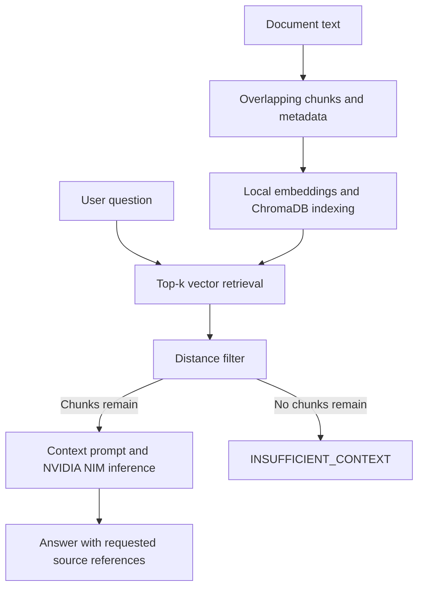

# Grounded RAG Knowledge Engine

A Python Retrieval-Augmented Generation (RAG) prototype that retrieves passages from a local document collection and uses a hosted language model to generate answers with source chunk references.

The pipeline combines overlapping word-based chunking, Pydantic data models, local SentenceTransformers embeddings, ChromaDB retrieval, and NVIDIA NIM inference. It uses direct SDK and database calls rather than LangChain or LlamaIndex orchestration.

## Features

- **Overlapping document chunks:** Splits text into word windows and attaches source metadata and chunk identifiers.
- **Runtime data validation:** Uses Pydantic models for chunks and metadata before indexing.
- **Local embeddings:** Encodes text with `sentence-transformers/all-MiniLM-L6-v2`, producing 384-dimensional vectors.
- **Vector retrieval:** Stores document text, embeddings, and metadata in an in-memory ChromaDB collection configured for cosine distance.
- **Retrieval filtering:** Excludes retrieved chunks with a cosine distance greater than `0.60` before generation.
- **Insufficient-context fallback:** Skips the LLM call if no retrieved chunks pass the distance filter.
- **Source-tagged generation:** Supplies chunk identifiers in the context and prompts the model to cite them in its answer.

## Architecture



### Query flow

1. Embed the question and retrieve the top-k closest document chunks.
2. Discard results whose cosine distance exceeds `0.60`.
3. Return `INSUFFICIENT_CONTEXT` immediately if no chunks remain.
4. Assemble the remaining chunks into a prompt with explicit source identifiers.
5. Ask the hosted model to answer from that context, include source references, and decline when the supplied context is insufficient.

## Tech stack

| Component | Technology | Purpose |
| --- | --- | --- |
| Language | Python 3.10+ | Pipeline implementation |
| Validation | Pydantic v2 | Chunk and metadata validation |
| Embeddings | SentenceTransformers, `all-MiniLM-L6-v2` | Local text encoding |
| Vector store | ChromaDB | In-memory cosine-distance retrieval |
| Inference client | OpenAI Python SDK | Requests to an OpenAI-compatible NVIDIA NIM endpoint |
| Hosted model | `nvidia/nemotron-3-super-120b-a12b` | Answer generation |
| Configuration | `python-dotenv` | Environment variable loading |

The embedding model runs locally; the answer-generation model is hosted. Retrieved context and the question are sent to the inference provider during generation. Local embedding execution does not make the entire pipeline offline or free to operate.

## Repository structure

```text
Grounded_Rag_Engine/
├── test_nim.py          # API connectivity check
├── chunker.py           # Chunking and Pydantic data models
├── vector_store.py      # Embeddings, indexing, and retrieval
├── rag_engine.py        # Query pipeline and context filtering
└── README.md
```

Create a local `.env` file for credentials and exclude it from version control.

## Setup

From the project directory, create and activate a virtual environment:

```bash
python3 -m venv .venv
source .venv/bin/activate
```

On Windows PowerShell, use the following activation command instead:

```powershell
.venv\Scripts\Activate.ps1
```

Install the dependencies:

```bash
pip install openai chromadb sentence-transformers "pydantic>=2,<3" python-dotenv
```

Add the following to your local `.env` file:

```dotenv
NVIDIA_NIM_API_KEY=your-api-key
```

Model availability, endpoint access, and API charges depend on the inference provider and account. The first use of SentenceTransformers may download the embedding model.

Run the pipeline:

```bash
python rag_engine.py
```

## Module details

### `chunker.py`

Creates `DocumentChunk` objects with `ChunkMetadata`, including a source, category, chunk ID, and word count. The window advances by `chunk_size - overlap`; for example, a 20-word chunk with a 5-word overlap advances by 15 words.

A valid configuration requires `chunk_size > 0` and `0 <= overlap < chunk_size`. These are configuration requirements; the source implementation should be checked for explicit enforcement.

### `vector_store.py`

Encodes document chunks and queries with the embedding model and uses a ChromaDB collection configured with `{"hnsw:space": "cosine"}`. Retrieval returns document text, metadata, and distance scores. Smaller cosine distances indicate closer vectors; cosine distance is `1 - cosine similarity`.

The documented collection is in memory. Do not assume indexed data survives a process restart.

### `rag_engine.py`

Filters retrieved chunks, constructs source-tagged context, and calls NVIDIA NIM through the OpenAI SDK. The prompt requests references such as `[sys_spec.md_chunk_1]` and an insufficient-context response when the answer is unavailable.

The configured `temperature=0.0` reduces sampling randomness; it does not guarantee identical responses across repeated requests.

## Illustrative behavior

If an indexed source explicitly states that its bearer tokens expire after 60 minutes, an answer may look like:

```text
Question: When do the bearer tokens described in this system expire?
Answer: They expire 60 minutes after generation. [sys_spec.md_chunk_1]
```

This is a fact about the example source, not a general OAuth2 expiration rule. Actual answers depend on the indexed content and model response.

When no retrieved chunk passes the distance filter, the pipeline returns an `INSUFFICIENT_CONTEXT` response without calling the model.

## Limitations and evaluation

- **Retrieval relevance is approximate.** A close embedding match may still lack the answer. The `0.60` cutoff is a configurable heuristic, not a universally validated threshold or probability of correctness.
- **Grounding is prompted.** Distance filtering and prompt instructions reduce opportunities for unsupported answers but do not eliminate hallucinations.
- **Citations are model-generated.** Supplying chunk identifiers does not prove that every generated claim is supported. Programmatic citation and claim verification are not established by this documentation.
- **Schema validity is separate from factual accuracy.** Valid chunk objects do not establish that source text is correct or trustworthy.
- **Retrieved text can contain misleading instructions.** The documented filtering does not establish protection against prompt injection in source documents.
- **The examples are demonstrations.** No retrieval benchmark, answer-quality score, latency measurement, or production reliability result is reported here.

Useful next steps include a labeled set of answerable and unanswerable questions, retrieval recall measurements, threshold tuning, citation checks, persistent indexing, and API error handling. These are proposed improvements, not claimed implemented features.
