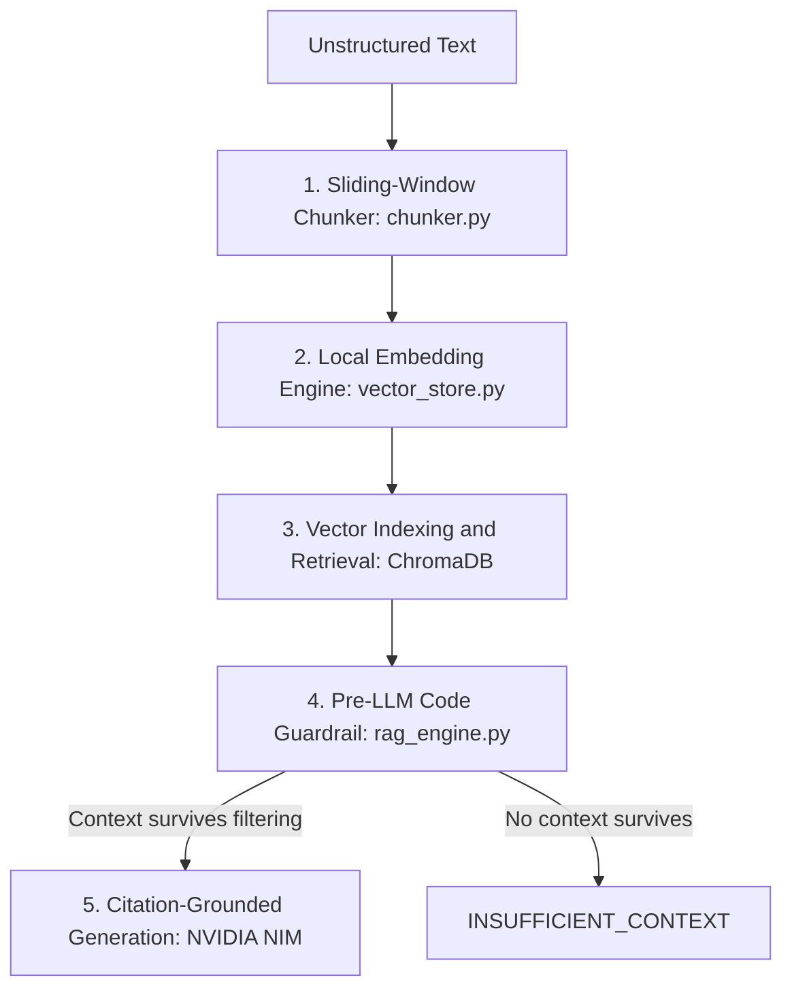

# Grounded RAG Knowledge Engine with Inline Citations & Dual-Layer Guardrails

A production-grade Retrieval-Augmented Generation (RAG) system built from scratch without high-level abstraction frameworks such as LangChain or LlamaIndex. This engine features Pydantic-validated sliding-window chunking, local vector similarity search via ChromaDB, code-level distance thresholding, and deterministic inline source citations powered by NVIDIA Nemotron 120B.

## Key Features

- **Metadata-Aware Sliding-Window Chunker:** Splits unstructured text into overlapping word windows to preserve semantic continuity across chunk boundaries.
- **Pydantic Runtime Schema Validation:** Enforces strict typing and data integrity through `DocumentChunk` and `ChunkMetadata` before indexing into the vector store.
- **Zero-Cost Local Vector Store:** Embeds text using local `sentence-transformers/all-MiniLM-L6-v2` (384 dimensions) and indexes vectors into an in-memory ChromaDB collection using Cosine Distance space.
- **Dual-Layer Hallucination Guardrails:**
  - **Code-Level Distance Thresholding:** Automatically filters out retrieved chunks with Cosine distance greater than `0.60` before making API calls.
  - **Prompt-Level Grounding:** Forces the LLM to provide inline citations, such as `[sys_spec.md_chunk_1]`, and trigger an explicit `INSUFFICIENT_CONTEXT` fallback when facts are missing.
- **OpenAI-Compatible Inference Layer:** Integrates directly with NVIDIA NIM microservices using the standard `openai` Python SDK pointing to `nvidia/nemotron-3-super-120b-a12b`.

## System Architecture



| Stage | Details |
| --- | --- |
| **1. Sliding-Window Chunker (`chunker.py`)** | Word-level overlap, for example a chunk size of 20 words and an overlap of 5 words. Validated through Pydantic `DocumentChunk` and metadata schemas. |
| **2. Local Embedding Engine (`vector_store.py`)** | Uses `sentence-transformers/all-MiniLM-L6-v2` to generate 384-dimensional dense vectors. |
| **3. Vector Indexing & Retrieval (ChromaDB)** | Uses Cosine Distance, calculated as `1 - Cosine Similarity`, with top-K similarity search. |
| **4. Pre-LLM Code Guardrail (`rag_engine.py`)** | Drops chunks where distance is greater than `0.60`. Returns `INSUFFICIENT_CONTEXT` immediately if no chunks remain. |
| **5. Citation-Grounded LLM Generation (NVIDIA NIM)** | Uses `nvidia/nemotron-3-super-120b-a12b` with `temperature=0.0` for deterministic generation and inline citations in the format `[source_chunk_id]`. |

## Tech Stack

| Component | Tool / Library | Role |
| --- | --- | --- |
| LLM Inference | NVIDIA NIM API through the `openai` SDK | `nvidia/nemotron-3-super-120b-a12b` for deterministic generation. |
| Vector DB | ChromaDB | In-memory vector database using HNSW Cosine Distance indexing. |
| Embedding Model | SentenceTransformers | `all-MiniLM-L6-v2` running locally on Mac CPU/GPU, producing 384-dimensional embeddings. |
| Data Validation | Pydantic v2 | Runtime schema validation for chunks and metadata. |
| Environment | `python-dotenv` | Secure environment variable handling. |

## Repository Structure

```text
Grounded_Rag_Engine/
├── .env                 # API keys (NVIDIA_NIM_API_KEY)
├── test_nim.py          # API connectivity test script
├── chunker.py           # Sliding-window chunker with Pydantic validation
├── vector_store.py      # Local embedding & ChromaDB vector search
├── rag_engine.py        # End-to-end grounded RAG execution pipeline
└── README.md            # Project documentation
```

## Installation & Setup

### 1. Prerequisites

- Python 3.10+
- NVIDIA NIM API key (free tier available on the NVIDIA Developer Portal)

### 2. Environment Setup

Clone this repository and create a virtual environment:

```bash
git clone https://github.com/YOUR_USERNAME/Grounded_Rag_Engine.git
cd Grounded_Rag_Engine
python3 -m venv .venv
source .venv/bin/activate
```

On Windows, activate the virtual environment with:

```powershell
.venv\Scripts\activate
```

Install the required dependencies:

```bash
pip install openai chromadb sentence-transformers pydantic python-dotenv
```

### 3. API Key Configuration

Create a `.env` file in the project root directory:

```dotenv
NVIDIA_NIM_API_KEY="nvapi-your-actual-api-key-here"
```

## Module Breakdown & How It Works

### 1. `chunker.py` — Schema Validation & Sliding-Window Chunker

Converts raw documents into structured `DocumentChunk` objects validated by Pydantic:

- **Overlapping Windows:** Advances a sliding window across document word lists by `chunk_size - overlap`.
- **Metadata Attachment:** Assigns a unique `chunk_id`, such as `sys_spec.md_chunk_0`, along with `source`, `category`, and a verified `word_count` to each chunk.

### 2. `vector_store.py` — Local Vector Indexing

- **Local Embedding:** Uses `all-MiniLM-L6-v2` locally to encode chunk strings into 384-dimensional dense vectors without sending data over external APIs.
- **ChromaDB Indexing:** Stores documents, vectors, and metadata in a Chroma collection configured with `{"hnsw:space": "cosine"}`.
- **Similarity Retrieval:** Queries the collection and returns top-K results along with raw documents, metadata dictionaries, and Cosine Distance scores.

### 3. `rag_engine.py` — Pipeline Controller & Guardrail Layer

Executes the end-to-end grounded query pipeline:

- **Code-Level Distance Cutoff:** Discards retrieved chunks whose Cosine Distance exceeds `0.60`.
- **Short-Circuit Refusal:** If no context survives filtering, immediately returns `INSUFFICIENT_CONTEXT` to prevent hallucination.
- **Context Injection & Citation System:** Wraps valid chunks with explicit identifiers, such as `--- BEGIN CHUNK [chunk_id] ---`, and instructs NVIDIA Nemotron to provide inline source tags.

## Usage & Execution

Run the main pipeline:

```bash
python rag_engine.py
```

## Example Outputs

### Test 1: Grounded Technical Query

```text
Query: 'When do OAuth2 bearer tokens expire?'

LLM Answer:
OAuth2 Bearer tokens expire exactly 60 minutes after generation. [sys_spec.md_chunk_1]
```

### Test 2: Out-of-Domain Query (Hallucination Guardrail Test)

```text
Query: 'What is the policy for employee hardware refunds?'

LLM Answer:
INSUFFICIENT_CONTEXT: No relevant knowledge found in database.
```

## Core Engineering Highlights

- **No Black-Box Frameworks:** Written using direct API calls and database clients for explicit control over data flow, distance thresholds, and memory management.
- **Hallucination Mitigation:** Employs a zero-trust model where data must pass both mathematical vector thresholds and prompt grounding constraints.
- **Deterministic Execution:** Uses `temperature=0.0` for predictable, verifiable API responses across production workloads.
